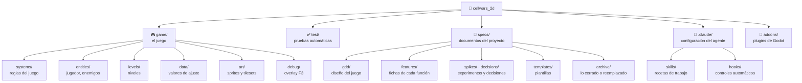
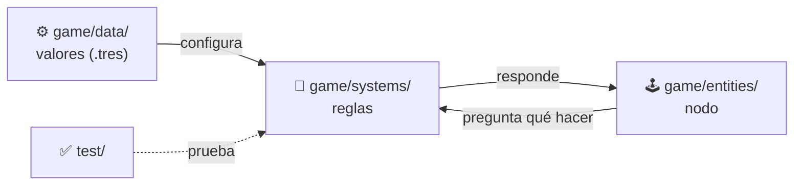
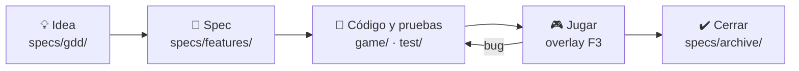

# Cellwars 2D

Plataformas 2D en pixel art hecho con **Godot 4.7** y **GDScript**. Proyecto open source, desarrollado por una persona con un agente de IA (Claude Code).

## Estructura de carpetas

El repo tiene cuatro zonas: **el juego**, **sus pruebas**, **los documentos** que dicen qué construir y **la configuración del agente**.



### Qué hay en cada carpeta

| Carpeta | Función |
|---|---|
| `game/systems/` | **Reglas del juego** en código puro (cómo salta el jugador, cómo corre un timer). No dependen de la escena, por eso se pueden probar solas. |
| `game/entities/` | **Escenas y nodos** del jugador, enemigos, objetos. Leen el input y aplican lo que deciden las reglas; no tienen reglas propias. |
| `game/levels/` | **Niveles**, armados con `TileMapLayer`. Los edita el desarrollador. |
| `game/data/` | **Valores de ajuste** (velocidad, altura de salto…) en archivos `.tres`, editables desde el inspector de Godot sin tocar código. |
| `game/art/` | Sprites y tilesets en pixel art. |
| `game/debug/` | Overlay de depuración (tecla **F3**): velocidad, estados, timers, FPS. |
| `test/` | Pruebas automáticas con gdUnit4. Es un espejo de `game/systems/`. |
| `specs/` | Todo lo que se **decide antes de construir**. Godot lo ignora (`.gdignore`). |
| `specs/gdd/` | Documento de diseño del juego: visión, controles, mecánicas, dirección de arte. |
| `specs/features/` | Una carpeta por función del juego, con su ficha (spec) y criterios de aceptación. |
| `specs/spikes/` · `specs/decisions/` | Experimentos con tiempo límite y las decisiones que salen de ellos. |
| `specs/templates/` | Plantillas para escribir cada tipo de documento. |
| `specs/archive/` | Lo cerrado o reemplazado. Nada se borra: se archiva. |
| `.claude/` | Configuración del agente: `skills/` (recetas de trabajo paso a paso) y `hooks/` (formato y lint automáticos en cada script). |
| `addons/` | Plugins de Godot (gdUnit4). |
| `prototypes/` | Código descartable de los experimentos. **Solo existe en las branches `spike/*`**, nunca en `develop` ni en `main`. |

Archivos sueltos en la raíz: `project.godot` (el proyecto), `CLAUDE.md` (reglas para el agente), `.mcp.json` (conexión del agente con Godot).

## Cómo se separa el código

Cada función del juego se reparte en tres piezas, cada una en su carpeta:



Así las reglas se prueban sin abrir el juego, y los valores se ajustan sin tocar código.

## Cómo se trabaja



Si algo es incierto (por ejemplo, cómo debe sentirse el salto), antes de la spec se hace un **spike**: un prototipo rápido en una branch aparte que termina en una decisión escrita. El detalle completo del flujo está en `CLAUDE.md`.

## Comandos

```bash
# Abrir el editor
godot -e

# Correr el juego
godot

# Pruebas automáticas (sin ventana)
godot --headless -s res://addons/gdUnit4/bin/GdUnitCmdTool.gd --ignoreHeadlessMode -a res://test -c
```

Requisitos: Godot 4.7, y para formato y lint [gdtoolkit](https://github.com/Scony/godot-gdscript-toolkit) (`pip install gdtoolkit`).
