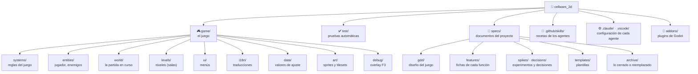
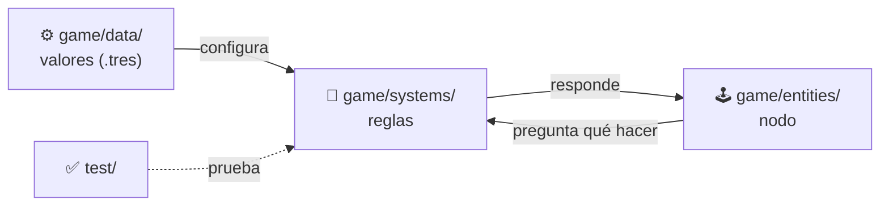
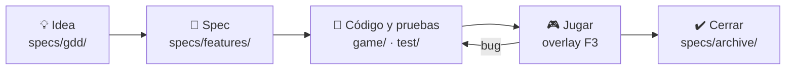

# Cellwars 2D

Plataformas 2D en pixel art hecho con **Godot 4.7** y **GDScript**. Proyecto open source, dirigido por dos personas, cada una con su agente de IA: Claude Code y GitHub Copilot en VS Code.

## Estructura de carpetas

El repo tiene cuatro zonas: **el juego**, **sus pruebas**, **los documentos** que dicen qué construir y **la configuración del agente**.



### Qué hay en cada carpeta

| Carpeta | Función |
|---|---|
| `game/systems/` | **Reglas del juego** en código puro (cómo salta el jugador, cómo corre un timer). No dependen de la escena, por eso se pueden probar solas. |
| `game/entities/` | **Escenas y nodos** del jugador, enemigos, objetos. Leen el input y aplican lo que deciden las reglas; no tienen reglas propias. |
| `game/main.tscn` | **Escena raíz**: queda siempre cargada y cambia entre el menú y la partida. |
| `game/world/` | **La partida en curso**: la escena activa mientras jugás. Carga las salas de `levels/` y pone al jugador y los enemigos de `entities/`. |
| `game/levels/` | **Niveles**, armados con `TileMapLayer`. Los editan los directores. |
| `game/ui/` | **Menús**: menú principal, pausa y opciones. |
| `game/i18n/` | **Traducciones**: una planilla con cada texto del juego en español e inglés. |
| `game/data/` | **Valores de ajuste** (velocidad, altura de salto…) en archivos `.tres`, editables desde el inspector de Godot sin tocar código. |
| `game/art/` | Sprites y tilesets en pixel art. |
| `game/debug/` | Overlay de depuración (tecla **F3**): velocidad, estados, timers, FPS. |
| `test/` | Pruebas automáticas con gdUnit4. Es un espejo de `game/systems/`. |
| `specs/` | Todo lo que se **decide antes de construir**. Godot lo ignora (`.gdignore`). |
| `specs/gdd/` | Documento de diseño del juego: visión, controles, mecánicas, dirección de arte. |
| `specs/features/` | Una carpeta por función del juego, con su ficha (spec) y criterios de aceptación. |
| `specs/spikes/` · `specs/decisions/` | Experimentos con tiempo límite y las decisiones que salen de ellos. |
| `specs/templates/` | Plantillas para escribir cada tipo de documento. |
| `specs/archive/` | Lo cerrado o reemplazado. Nada se borra: se archiva. |
| `.github/skills/` | **Recetas de trabajo** paso a paso (escribir una spec, implementar, probar, cerrar), compartidas por los dos agentes. |
| `.claude/` | Configuración de Claude Code: un enlace a las recetas y `hooks/` (formato automático en cada script). |
| `.vscode/` | Configuración de Copilot en VS Code: conexión con Godot y terminal. |
| `addons/` | Plugins de Godot (gdUnit4). |
| `prototypes/` | Código descartable de los experimentos. **Solo existe en las branches `spike/*`**, nunca en `develop` ni en `main`. |

Archivos sueltos en la raíz: `project.godot` (el proyecto), `AGENTS.md` (reglas para los agentes), `CLAUDE.md` (las incluye para Claude Code), `.mcp.json` (conexión de Claude Code con Godot).

## Cómo se separa el código

Cada función del juego se reparte en tres piezas, cada una en su carpeta:



Así las reglas se prueban sin abrir el juego, y los valores se ajustan sin tocar código.

Para ver cómo se conectan las piezas del juego (nodos, reglas y señales), está el [mapa del código](specs/architecture.md#mapa-del-código).

## Cómo se trabaja



Si algo es incierto (por ejemplo, cómo debe sentirse el salto), antes de la spec se hace un **spike**: un prototipo rápido en una branch aparte que termina en una decisión escrita. El detalle completo del flujo está en `AGENTS.md`.

## Sumarse como director (Windows y VS Code)

Un director decide qué se construye, aprueba y prueba. No necesita saber programar ni entrar a GitHub: todo se habla con el agente, en el chat de Copilot. Esto se hace una sola vez.

1. **Cuenta de GitHub**: creá una y aceptá la invitación al repo, que te manda el otro director.
2. **Programas**: en PowerShell, `winget install Microsoft.VisualStudioCode Git.Git GitHub.cli OpenJS.NodeJS.LTS Python.Python.3.12`. Después, en una terminal nueva, `pip install gdtoolkit` (revisa el formato del código).
3. **Godot 4.7**: bajá la versión estable para Windows (la común, no la .NET) de godotengine.org. Poné el ejecutable en `C:\Godot`, renombralo a `godot.exe` y agregá esa carpeta al PATH (*Editar las variables de entorno del sistema*). En una terminal nueva, `godot --version` tiene que responder.
4. **Tu nombre**: en Git Bash, `git config --global user.name "Tu nombre"`, `git config --global user.email "tu@mail"` y `gh auth login`.
5. **El proyecto**: `gh repo clone rledesma912/cellwars_2d`, y abrí esa carpeta en VS Code.
6. **Copilot**: instalá la extensión GitHub Copilot e iniciá sesión. Abrí el chat en modo agente y, si tu plan lo permite, elegí un modelo Claude. La primera vez que el agente use Godot, VS Code te pide la ruta: `C:\Godot\godot.exe`.

Para empezar, contale al agente qué querés que tenga el juego, por ejemplo: *"Quiero que Elyon pueda agacharse"*. Él te explica cómo lo entiende y te pide que lo apruebes; después lo construye, te dice qué probar y anota lo que le cuentes. Hay un solo trabajo abierto a la vez: si el otro director tiene uno, el agente te avisa.

## Comandos

```bash
# Abrir el editor
godot -e

# Correr el juego
godot

# Pruebas automáticas (sin ventana)
godot --headless -s res://addons/gdUnit4/bin/GdUnitCmdTool.gd --ignoreHeadlessMode -a res://test -c
```

Requisitos: Godot 4.7, y para formato y lint [gdtoolkit](https://github.com/Scony/godot-gdscript-toolkit) (`pip install gdtoolkit`).
