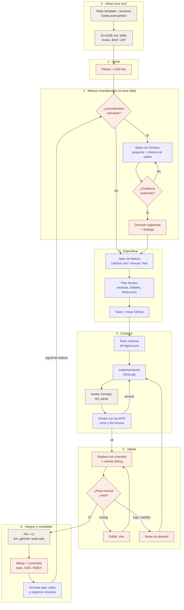

# Traspaso: flujo de desarrollo agéntico para un plataformas 2D en Godot

> **Registro histórico (Fase 0).** Las reglas vigentes están en `CLAUDE.md`, `.claude/skills/` y `specs/templates/`. Ante cualquier diferencia con este documento, mandan esos.

> Documento de arranque para Claude Code. Resume las decisiones tomadas en la fase de diseño del flujo de trabajo.
> **Claude Code: leé este documento completo antes de hacer cualquier cosa.** Las instrucciones de cómo usarlo están en la sección 12.

---

## 1. Contexto

- Desarrollador: arquitecto de software, trabaja **solo**. Viene de desarrollar web, APIs, servicios y workers con un harness agéntico: GitHub + Spec Driven Development (SDD) + Claude Code + Skills + MCP. Quiere que este flujo **se parezca lo más posible a ese harness**.
- Objetivo: un **plataformas 2D en pixel art**, con aspecto moderno.
- Está aprendiendo GDScript: explicá decisiones no obvias de Godot en comentarios breves y en los PRs.
- Restricción de costos: **todo open source**. Lo único pago es el plan de Claude Code.

### Vocabulario del proyecto

| Término | Significado en este repo |
|---|---|
| GDD | Game Design Document: qué juego es, sus reglas y la experiencia buscada. Modular, en `specs/gdd/`. |
| Spike | Investigación acotada (con timebox) para reducir una incertidumbre antes de decidir. Puede ser técnica o de gameplay. Su producto es evidencia y una recomendación, no código de producción. |
| Decisión (ADR) | Registro corto de una decisión, sus alternativas y su motivo. En `specs/decisions/`. |
| Spec | Especificación funcional de una feature con criterios de aceptación verificables e identificados. |
| Plan | Diseño técnico de una feature (escenas, scripts, señales, Resources). **No usar la sigla "TDD"** en el repo: es ambigua entre Technical Design Document y Test-Driven Development. |
| Arquitectura | Decisiones técnicas transversales, en `specs/architecture.md`. |
| LSP | Protocolo que permite al agente consultar información estructural del código. Herramienta opcional, no fase del proceso. |

## 2. Decisiones tomadas

| Tema | Decisión |
|---|---|
| Motor | Godot 4.7.x estable (verificar el último patch al instalar) |
| Lenguaje | GDScript (sin C#) |
| Renderer | Compatibility (`gl_compatibility`): suficiente para 2D y habilita export web |
| Tamaño de tile | **32 px** |
| Resolución base | **640×360** (escala entera ×2 a 720p, ×3 a 1080p, ×4 a 1440p, ×6 a 4K). Con tiles de 32 px se ven ~20×11 tiles. Alternativa si se siente muy "cerca": 960×540 (~30×17 tiles, pero no escala entero a 1440p). **Se valida en el spike de movimiento.** |
| Niveles | `TileMapLayer` nativo. Sin LDtk ni editores externos. |
| Arte | Pixelorama o LibreSprite (open source). Greybox hasta que un sistema pase su criterio `[feel]`. |
| Unit tests | gdUnit4, solo sobre lógica pura, headless |
| Formato / lint | gdtoolkit (`gdformat`, `gdlint`) |
| LSP | Recomendado, no obligatorio: plugin de Claude Code que hace de puente al LSP nativo de Godot (TCP 6005) |
| MCP | `Coding-Solo/godot-mcp` (MIT): correr el proyecto y leer errores/consola |
| Skills base | GodotPrompter (patrones Godot 4.x) + skills propias de proceso (sección 9) |
| Testing manual | Lo hace el desarrollador. No hace falta testing automático de escenas al inicio. |
| CI | Postergado. Diseñado pero no implementado (sección 11). |

## 3. Principios del flujo

1. **Spike solo cuando hay incertidumbre relevante.** No toda feature lleva spike. Es obligatorio cuando se cumple al menos una:
   - Una mecánica central cuyo "feel" no se conoce (movimiento, combate, cámara). En juegos, la spec formaliza algo que ya se probó que es divertido.
   - Hay dos o más enfoques técnicos plausibles y elegir mal es caro de revertir.
   - Hay dudas de viabilidad o rendimiento (cantidad de entidades, física, export web).
   - Integra algo que nunca se usó en el proyecto (addon, formato, plataforma).
   Si no aplica ninguna, se va directo a la spec. Todo spike tiene pregunta, timebox, criterios de salida y entregable (plantilla en la sección 10).
   Límites para que los spikes no se acumulen:
   - **Un solo spike abierto a la vez.** No se abre otro hasta cerrar el actual.
   - **El timebox se respeta.** Si vence sin evidencia suficiente, el agente se detiene y propone: cerrar con lo que se sabe, o una única extensión con un nuevo límite. Vos decidís.
   - **El código de un spike nunca llega a `main`.** Vive en `prototypes/spike_NNN/` dentro de la branch del spike.
   - Expectativa de volumen: entre 3 y 6 spikes en todo el proyecto.
2. **Las decisiones se registran.** Todo spike termina en una decisión registrada en `specs/decisions/`, que luego actualiza el GDD, la arquitectura o una spec. Las decisiones técnicas importantes tomadas fuera de un spike también se registran.
3. **El código de un spike no es de producción.** Por defecto se descarta. Si se quiere reutilizar, la decisión lo dice explícitamente y el código pasa por la spec y la revisión normales.
4. **Verificación en capas**, y cada criterio de aceptación declara cuál usa:
   - `[unit]`: lo verifica gdUnit4 sobre lógica pura. Lo cierra el agente.
   - `[manual]`: comprobable jugando, con resultado objetivo ("puedo subir a una plataforma de 3 tiles"). Lo cierra el desarrollador.
   - `[feel]`: subjetivo ("el salto se siente controlable"). **Solo lo cierra el desarrollador.** El agente nunca marca un `[feel]` como cumplido.
5. **Smoke run antes de entregar.** Antes de pedirle un playtest al desarrollador, el agente corre el juego vía MCP y confirma que no hay errores en consola.
6. **Las specs son la fuente de verdad y el agente no las cambia solo.** El agente que implementa no modifica criterios de aceptación, GDD ni decisiones aprobadas. Si descubre que la spec es incorrecta o inviable, se detiene y propone el cambio; el desarrollador lo aprueba. Ver la tabla de permisos en la sección 9.
7. **Trazabilidad.** Cada criterio tiene un ID (`F003-AC02`). Los tests lo citan en su nombre, las tasks lo referencian y el playtest lo marca. Cadena: GDD → (spike → decisión) → spec → plan → tasks → tests / playtest → PR.
8. **Documentación mínima suficiente.** Un artefacto existe solo si aporta claridad, trazabilidad o verificación. Features chicas usan la vía liviana (sección 10).
9. **Los niveles son del desarrollador.** El agente no edita `.tscn` dentro de `game/levels/` salvo pedido explícito.
10. **El tuning no pasa por el agente.** Todo valor ajustable vive en un Resource `.tres` en `game/data/` que el desarrollador edita en el inspector.
11. **Documentos vivos contra registros.** Los documentos se dividen en dos clases:
    - **Vivos** (describen el juego *hoy*): `gdd/`, `architecture.md`, `spec.md` de features, `INDEX.md`, `backlog.md`. Se reescriben para reflejar la verdad actual. **Nunca contienen ideas descartadas, decisiones reemplazadas ni preguntas ya resueltas.**
    - **Registros** (cuentan *cómo se llegó*): spikes y decisiones. No se editan una vez cerrados. Cuando dejan de ser vigentes se mueven a `specs/archive/`.
    Nada se borra: lo que sale de un documento vivo va a `specs/archive/` o queda en el historial de git. Las ideas descartadas se registran en una línea en `specs/discarded.md`. El objetivo es que el desarrollador pueda leer los documentos vivos para repasar el juego, y que el agente no reflote contenido obsoleto.
12. **Consolidar es parte de terminar.** Ningún spike ni feature está cerrado hasta que sus resultados se consolidaron en los documentos vivos (ver "Ciclo de vida de los documentos" en la sección 10).

## 4. Flujo



Violeta: agente. Naranja: desarrollador. Gris: automático.

### Mapeo con el harness web del desarrollador

| Web / API | Plataformas |
|---|---|
| PRD / requisitos | Pilares + GDD-lite |
| Spike técnico | Spike técnico o de gameplay, solo con incertidumbre relevante |
| ADR | Registro de decisión en `specs/decisions/` |
| Spec con criterios | Spec con criterios `[unit]` / `[manual]` / `[feel]` |
| Diseño técnico | Plan: árbol de escenas, señales, Resources |
| Tests de contrato | gdUnit4 sobre lógica pura |
| Smoke test | Smoke run vía MCP |
| QA / UAT | Playtest del desarrollador con checklist |
| Config / feature flags | Resources `.tres` de tuning |
| Deploy a staging | Build web en CI (futuro) |

### Branches y GitHub

- `spike/NNN-nombre`: spikes. **No se mergean a `main`.** El código del prototipo va en `prototypes/spike_NNN/` dentro de la branch. Solo los documentos (definición, informe, decisión) se commitean en `main`. Al cerrar, la branch se marca con el tag `archive/spike-NNN` (para poder recuperar el código si hiciera falta) y se borra, local y remota.
- `feat/NNN-nombre`: features. Una issue de GitHub por feature, enlazada a su carpeta de spec.
- PR con el checklist de playtest. El desarrollador mergea después de jugar.
- Commits convencionales (`feat:`, `fix:`, `spike:`, `docs:`, `chore:`).

## 5. Arquitectura de código

**Regla central: lógica pura + nodo fino + config en Resource.**

- La lógica de juego vive en clases `RefCounted` sin dependencia del árbol de escenas, en `game/systems/`. Son las únicas que llevan unit tests.
- Los nodos (`CharacterBody2D`, `Area2D`, etc.) leen input, llaman a la lógica pura y aplican el resultado. No contienen reglas.
- Los parámetros ajustables son Resources tipados con `@export` (por ejemplo `PlayerMovementConfig`), instanciados como `.tres` en `game/data/`.
- Comunicación entre sistemas por señales. Evitar `get_node()` con rutas largas y autoloads innecesarios (como máximo, un bus de eventos y el estado global del juego).
- Física a 60 ticks. El movimiento se calcula en `_physics_process`.

Ejemplo de la forma esperada (bosquejo, no código final):

```gdscript
# game/systems/player/player_motor.gd
class_name PlayerMotor
extends RefCounted

var config: PlayerMovementConfig
var _coyote_timer := 0.0
var _jump_buffer_timer := 0.0

func _init(p_config: PlayerMovementConfig) -> void:
	config = p_config

## Devuelve la nueva velocidad. Sin efectos sobre nodos: testeable en aislamiento.
func step(velocity: Vector2, input: PlayerInput, on_floor: bool, delta: float) -> Vector2:
	# coyote time, jump buffer, salto variable, aceleración/fricción...
	return velocity
```

```gdscript
# game/entities/player/player.gd
extends CharacterBody2D

@export var config: PlayerMovementConfig
var _motor: PlayerMotor

func _ready() -> void:
	_motor = PlayerMotor.new(config)

func _physics_process(delta: float) -> void:
	velocity = _motor.step(velocity, PlayerInput.from_actions(), is_on_floor(), delta)
	move_and_slide()
```

### Debug overlay

Desde la primera feature existe `game/debug/debug_overlay.tscn` (autoload o hijo del nivel), activable con F3, que muestra: estado del jugador, velocidad, `is_on_floor`, timers de coyote y buffer, y FPS. Cada sistema nuevo agrega sus líneas. Es la herramienta principal del playtest.

## 6. Estructura del repo

```
/
├── project.godot            # proyecto en la raíz: MCP y LSP lo encuentran sin config extra
├── CLAUDE.md
├── HANDOFF.md               # este documento (moverlo a specs/ después del setup)
├── specs/                   # contiene un archivo .gdignore vacío para que Godot no lo importe
│   ├── gdd/                 # modular; empieza chico y crece
│   │   ├── vision.md        # premisa, pilares, público, plataformas
│   │   ├── controls.md
│   │   ├── mechanics/       # un archivo por mecánica (movement.md, combat.md...)
│   │   └── art-direction.md
│   ├── INDEX.md             # VIVO: qué puede hacer el jugador hoy; punto de entrada para repasar el juego
│   ├── architecture.md      # VIVO: decisiones técnicas transversales vigentes
│   ├── backlog.md           # VIVO: lo que falta hacer
│   ├── discarded.md         # una línea por idea descartada, con motivo y enlace
│   ├── templates/           # plantillas de la sección 10
│   ├── spikes/NNN-nombre.md         # solo spikes abiertos o recién cerrados
│   ├── decisions/NNNN-titulo.md     # solo decisiones vigentes
│   ├── features/NNN-nombre/         # en curso: spec, plan, tasks, playtest; cerradas: solo spec.md
│   └── archive/                     # registros vencidos y artefactos de trabajo cerrados
│       ├── spikes/
│       ├── decisions/
│       └── features/NNN-nombre/     # plan.md, tasks.md, playtest.md de features cerradas
├── game/
│   ├── systems/             # lógica pura (RefCounted)
│   ├── entities/            # escenas + nodos finos (player, enemies, pickups)
│   ├── levels/              # del desarrollador
│   ├── data/                # .tres de tuning
│   ├── art/                 # sprites, tilesets
│   ├── debug/
│   └── main.tscn
├── test/                    # gdUnit4, espejo de game/systems/
├── addons/                  # gdUnit4 (y otros addons)
├── .claude/
│   ├── settings.json        # hooks
│   ├── hooks/
│   ├── skills/
│   └── agents/
├── .gitignore               # incluir .godot/ y *.translation; NO ignorar *.uid
└── .gitattributes           # LF y tratamiento de binarios (png, wav, ogg)
```

Notas:
- Los archivos `.uid` (Godot 4.4+) **se commitean**.
- `.godot/` y los `*.import` generados no se editan nunca a mano.

## 7. Configuración pixel-perfect (project.godot)

```ini
[display]
window/size/viewport_width=640
window/size/viewport_height=360
window/size/window_width_override=1280
window/size/window_height_override=720
window/stretch/mode="viewport"
window/stretch/aspect="keep"
window/stretch/scale_mode="integer"

[rendering]
renderer/rendering_method="gl_compatibility"
textures/canvas_textures/default_texture_filter=0   ; Nearest
2d/snap/snap_2d_transforms_to_pixel=true
```

A validar en el spike de movimiento:
- `snap_2d_transforms_to_pixel` combinado con `Camera2D` con suavizado puede producir jitter. Probar ambas variantes y documentar el resultado en los findings.
- Ajustar `viewport` 640×360 contra 960×540 según cuántos tiles se quieren ver.
- Tamaño del jugador respecto del tile de 32 px.

Input map inicial: `move_left`, `move_right`, `move_up`, `move_down`, `jump`, `dash` (reservado), `debug_toggle` (F3). Teclado y gamepad desde el inicio.

## 8. Tooling (Fase 0)

Verificar cada comando contra la documentación actual de su proyecto antes de ejecutarlo; algunos pueden haber cambiado.

| Herramienta | Instalación | Para qué |
|---|---|---|
| Godot 4.7.x | Binario oficial; dejar `godot` en el PATH | Motor y CLI headless |
| gdtoolkit | `pipx install "gdtoolkit==4.*"` | `gdformat`, `gdlint` |
| gdUnit4 | Addon en `addons/gdUnit4` (Asset Library o GitHub `MikeSchulze/gdUnit4`), versión compatible con 4.7 | Unit tests |
| godot-mcp | `claude mcp add godot -- npx @coding-solo/godot-mcp` (requiere Node 18+; revisar el README por variables como la ruta de Godot) | Correr el proyecto, leer consola y errores |
| LSP GDScript | Plugin `twaananen/claude-code-gdscript` u otro puente equivalente al LSP de Godot | Diagnósticos, go-to-definition |
| GodotPrompter | `claude plugins marketplace add jame581/skillsmith` y luego `claude plugins install godot-prompter@skillsmith` | Patrones Godot 4.x |
| jq | Paquete del sistema | Lo usa el hook |

Comando de tests (verificar sintaxis en la doc de gdUnit4):

```bash
godot --headless -s res://addons/gdUnit4/bin/GdUnitCmdTool.gd --ignoreHeadlessMode -a res://test -c
```

### Hooks de Claude Code

`.claude/settings.json`:

```json
{
  "hooks": {
    "PostToolUse": [
      {
        "matcher": "Write|Edit",
        "hooks": [
          { "type": "command", "command": "\"$CLAUDE_PROJECT_DIR\"/.claude/hooks/gd-check.sh" }
        ]
      }
    ]
  }
}
```

`.claude/hooks/gd-check.sh` (con permiso de ejecución):

```bash
#!/usr/bin/env bash
# Formatea y lintea cada .gd que el agente escribe. Exit 2 devuelve los errores al agente.
set -uo pipefail
file=$(jq -r '.tool_input.file_path // empty')
[[ "$file" == *.gd ]] || exit 0
gdformat "$file" >/dev/null 2>&1
if ! out=$(gdlint "$file" 2>&1); then
  echo "$out" >&2
  exit 2
fi
exit 0
```

Opcional más adelante: un hook `Stop` que corra los tests de `test/` cuando haya cambios en `game/systems/`.

## 9. Skills y agentes propios a crear

Skills de proceso en `.claude/skills/`. Cada una referencia su plantilla de `specs/templates/`.

| Skill | Hace |
|---|---|
| `spike` | Redacta la definición del spike (pregunta, motivo, timebox, criterios de salida) y pide aprobación. Luego crea la branch `spike/NNN-*`, construye el prototipo mínimo y escribe el informe en `specs/spikes/`. Propone la decisión en `specs/decisions/` para que el desarrollador la apruebe. |
| `spec-feature` | Evalúa si la feature necesita spike (criterios del principio 1) y, si no, redacta `spec.md` desde el GDD y las decisiones, con criterios identificados y etiquetados. Elige vía completa o liviana. Pide aprobación antes de seguir. |
| `plan-feature` | Redacta `plan.md` (árbol de escenas, scripts, señales, Resources, qué se testea) y `tasks.md`. Crea la issue en GitHub. |
| `implement-task` | Toma una task: primero tests `[unit]`, luego implementación, luego smoke run vía MCP. |
| `playtest-checklist` | Genera `playtest.md` desde los criterios `[manual]` y `[feel]`, con pasos concretos y qué mirar en el overlay F3. Lo incluye en el PR. |
| `close-spike` | Tras aprobarse la decisión: aplica sus consecuencias a los documentos vivos (GDD, `architecture.md`, specs), mueve el informe a `archive/spikes/`, agrega la línea a `discarded.md` si la idea se descartó, crea el tag `archive/spike-NNN` sobre la branch y la borra (pidiendo confirmación antes de borrar). Al terminar verifica que `specs/spikes/` no tenga ese spike y que la branch no exista. |
| `close-feature` | Tras el merge: consolida la spec como "as-built" (ver sección 10), actualiza `INDEX.md`, el GDD y el backlog, y mueve plan, tasks y playtest a `archive/features/`. |
| `curate-specs` | Curación periódica (al cerrar un milestone, cada ~5 features o a pedido). Produce un informe y propone los cambios en un PR, sin aplicarlos solo. Detecta: contradicciones entre GDD, specs y decisiones vigentes; referencias a documentos archivados o reemplazados; contenido descartado o deprecado que sigue en documentos vivos; preguntas abiertas viejas; borradores abandonados; features cerradas que faltan en `INDEX.md`; frontmatter inconsistente. |
| `godot-conventions` | Reglas de la sección 5 y 6 con ejemplos; la consultan las otras skills. |

### Permisos sobre los artefactos

| Artefacto | El agente puede | Aprueba / modifica |
|---|---|---|
| GDD (`specs/gdd/`) | Proponer cambios | Desarrollador |
| Decisiones (`specs/decisions/`) | Redactar propuesta desde un spike | Desarrollador (una aprobada no se edita; se reemplaza con una nueva) |
| `spec.md` | Redactar borrador | Desarrollador. Una vez aprobada, el agente no cambia criterios: propone |
| `plan.md`, `tasks.md` | Redactar y actualizar | Desarrollador revisa |
| Código, tests | Implementar | Revisión en PR |
| `playtest.md` | Generar checklist | El desarrollador marca `[manual]` y `[feel]` |
| Niveles, `.tres` de tuning | No tocar salvo pedido | Desarrollador |
| Consolidación y archivo | Ejecutarlos con `close-spike`, `close-feature` y `curate-specs`, siempre vía PR | Desarrollador aprueba. El agente nunca borra: mueve a `archive/` |
| `INDEX.md`, `discarded.md` | Actualizar como parte de la consolidación | Desarrollador revisa en el PR |

Agente opcional en `.claude/agents/`: `godot-reviewer`, que revisa un diff contra las convenciones (lógica fuera de nodos, Resources para tuning, no tocar niveles, señales en vez de rutas) antes de abrir el PR.

## 10. Plantillas y ciclo de vida de los documentos

### Frontmatter común

Todo documento de `specs/` (excepto `INDEX.md`, `discarded.md` y `backlog.md`) empieza con:

```yaml
---
id: F003                # F = feature, S = spike, D = decisión, G = sección del GDD
type: feature           # feature | spike | decision | gdd
status: approved        # draft | approved | in-progress | done | superseded | discarded
superseded_by:          # id que lo reemplaza, si aplica
links:
  gdd: [mechanics/movement.md]
  decisions: [D0002]
  spike: S001
updated: 2026-10-21
---
```

Los criterios de aceptación **no** se duplican en el frontmatter: viven en el cuerpo con su ID. El frontmatter permite que el agente filtre por estado y siga enlaces con grep, y es la base del futuro `tools/trace.py` (sección 11).

### Ciclo de vida

| Documento | Mientras está abierto | Al cerrarse |
|---|---|---|
| Spike (documento) | `specs/spikes/`, se edita libremente. Como máximo uno abierto. | Decisión aprobada → `close-spike` → `archive/spikes/` |
| Spike (código) | `prototypes/spike_NNN/` en la branch `spike/NNN-*`, nunca en `main` | Tag `archive/spike-NNN` + branch borrada |
| Decisión | `propuesta` en `specs/decisions/` | `aprobada`: queda. `superseded`: pasa a `archive/decisions/` y los documentos vivos que la citaban apuntan a la nueva |
| Spec de feature | `draft` → `approved` → `in-progress` | `done`: se consolida como *as-built* y queda en `features/` |
| Plan, tasks, playtest | Junto a la spec | `close-feature` → `archive/features/` (el código y los tests son ahora la verdad técnica) |
| Feature descartada | — | Carpeta completa a `archive/features/` + línea en `discarded.md` |
| Idea descartada en un spike o en el GDD | — | Se quita del documento vivo + línea en `discarded.md` |

**Spec as-built** (lo que hace `close-feature`): estado `done`; criterios con su resultado final; sin "preguntas abiertas" (cada una quedó resuelta en la spec o en una decisión); los parámetros de tuning **referencian el `.tres`** en vez de copiar números que van a quedar desactualizados; una sección corta "Notas finales" con lo aprendido en el playtest que valga la pena recordar. El resto de las notas de playtest va al archivo.

### `specs/INDEX.md`

```markdown
# Estado del juego
> Documento vivo. Qué puede hacer el jugador hoy. Lo actualiza `close-feature`.

## Movimiento
- **F001 Movimiento base**: correr, salto variable, coyote time, jump buffer. → [spec](features/001-movimiento/spec.md)

## (otras categorías: combate, enemigos, niveles, UI...)

## En curso
- F004 ...
```

### `specs/discarded.md`

```markdown
# Ideas descartadas
> Una línea por idea. Sirve para no olvidar qué se evaluó y para que el agente no la vuelva a proponer sin motivo nuevo.

| Fecha | Idea | Motivo | Referencia |
|---|---|---|---|
| 2026-11-02 | Doble salto | Rompía el diseño de niveles verticales | archive/spikes/001-movimiento.md, D0001 |
```

Regla para el agente: antes de proponer una mecánica o enfoque, revisar `discarded.md`. Si está ahí, solo se reabre si hay un motivo nuevo, y se dice explícitamente.

### `specs/templates/spike.md`

```markdown
# Spike NNN: <nombre>
- Branch: spike/NNN-<nombre>
- Tipo: gameplay | técnico | viabilidad | integración
- Origen: GDD <archivo §> / feature NNN

## Definición (se aprueba antes de empezar)
- Pregunta: <qué incertidumbre resuelve, en una frase>
- Motivo: <por qué importa resolverla antes de seguir>
- Timebox: <horas> (vence: <fecha>; extensiones usadas: 0 de 1)
- Criterios de salida: <qué evidencia alcanza para decidir>
- Alternativas a evaluar: <si aplica>
- Destino del código: descartar (por defecto) | reutilizar tras revisión

## Qué se construyó
## Evidencia y findings
## Valores de tuning que funcionaron
| Parámetro | Valor | Nota |
## Riesgos y limitaciones
## Recomendación
## Siguiente paso
- [ ] Decisión NNNN → actualizar GDD / arquitectura / spec
- [ ] Otro spike (qué incertidumbre queda)
- [ ] Descartar la idea (motivo)
```

### `specs/templates/decision.md`

```markdown
# NNNN: <título de la decisión>
- Estado: propuesta | aprobada | reemplazada por NNNN
- Fecha:
- Origen: spike NNN / feature NNN

## Contexto
## Opciones consideradas
## Decisión
## Consecuencias (qué se actualiza: GDD, architecture.md, specs)
```

### `specs/templates/spec.md`

```markdown
# Feature NNN: <nombre>
- Estado: draft | aprobada | en curso | hecha
- Origen: GDD <archivo §> / decisión NNNN
- Issue: #
- Vía: completa | liviana

## Objetivo
## Fuera de alcance
## Criterios de aceptación
- FNNN-AC01 [unit] ...
- FNNN-AC02 [manual] ...
- FNNN-AC03 [feel] ...
## Casos límite
## Parámetros de tuning (Resource)
| Parámetro | Tipo | Valor inicial | Rango sugerido |
## Preguntas abiertas
```

**Vía liviana** (features chicas sin incertidumbre, por ejemplo un pickup o un pinche): un único `spec.md` que agrega al final una sección "Plan y tasks" de pocas líneas. El playtest va directo en el PR. Se usa la vía completa cuando la feature toca más de un sistema, introduce un sistema nuevo o tiene criterios `[feel]`.

### `specs/templates/plan.md`

```markdown
# Plan: feature NNN
## Árbol de escenas
## Scripts y responsabilidades
| Archivo | Tipo (lógica pura / nodo / Resource) | Responsabilidad |
## Señales
## Qué se testea con gdUnit4
## Impacto en overlay debug
## Riesgos
```

### `specs/templates/tasks.md`

```markdown
# Tasks: feature NNN
- [ ] T1 <descripción> (cubre: FNNN-AC01, FNNN-AC02)

Los tests de gdUnit4 incluyen el ID en el nombre, por ejemplo `test_f001_ac01_coyote_time_allows_late_jump`.
```

### `specs/templates/playtest.md`

```markdown
# Playtest: feature NNN
## Preparación (escena, overlay F3)
## Checklist [manual]
- [ ] Paso → resultado esperado
## Checklist [feel]
- [ ] ¿...? (anotar sensación y valor de tuning probado)
## Notas del playtest
```

## 11. Postergado (diseñado, no implementar todavía)

- CI en GitHub Actions: `gdformat --check` + `gdlint`, gdUnit4 headless (la lógica pura no requiere GPU ni xvfb), export web.
- Export web y publicación (itch.io o GitHub Pages).
- Tests de escena con input simulado (gdUnit4 scene runner).
- MCP con screenshots / input simulado para que el agente "vea" el juego.
- Pipeline de assets (import de spritesheets, animaciones).
- `tools/trace.py`: recorre `specs/` y `test/`, lee el frontmatter y los IDs de criterios, y genera la matriz de trazabilidad (criterio → test → estado de playtest → decisión de origen). Sirve como apoyo de `curate-specs` y luego como chequeo de CI ("criterio `[unit]` sin test" falla el build). Si alguna vez hacen falta consultas complejas, puede volcar a un SQLite descartable; los `.md` siguen siendo la única fuente de verdad. **No usar una base de datos como fuente de verdad.**

## 12. Instrucciones para Claude Code

1. Leé todo este documento. Si algo es ambiguo o contradictorio, preguntá antes de construir.
2. Proponé un plan para la **Fase 0** y esperá aprobación. Ejecutalo por pasos, confirmando cada instalación de herramientas externas.
3. La Fase 0 termina cuando: el proyecto abre en Godot con la config de la sección 7; existe `main.tscn` con un nivel de prueba vacío; `gdformat`/`gdlint` y el hook funcionan; gdUnit4 corre un test trivial en headless; el MCP puede correr el proyecto y leer la consola; existen `CLAUDE.md`, `specs/architecture.md` (inicial, desde la sección 5), `specs/INDEX.md` y `specs/discarded.md` vacíos con su encabezado, la carpeta `specs/archive/`, las plantillas y las skills de la sección 9. El LSP es recomendado pero no bloquea el cierre. Reportá cada punto como verificado o no.
4. Generá `CLAUDE.md` condensando las secciones 2, 3, 5, 6, la tabla de permisos de la sección 9 y el ciclo de vida de la sección 10 (reglas, no explicaciones largas). Incluí estas reglas de lectura: para entender el estado del juego, empezar por `specs/INDEX.md`; ignorar `specs/archive/` salvo que se pida investigar historia; revisar `specs/discarded.md` antes de proponer mecánicas o enfoques.
5. Después de la Fase 0, el desarrollador escribe con vos `specs/gdd/vision.md` (premisa y pilares). El primer trabajo es el **Spike 001: movimiento del jugador** (correr, saltar, salto variable, coyote time, jump buffer, cámara). Cumple los criterios de spike por dos motivos: es la mecánica central y su "feel" no se conoce, y además valida resolución, snap a píxel y tamaño del personaje. Debe cerrar con una decisión registrada antes de escribir la spec de la feature 001.
6. Mové este archivo a `specs/` una vez terminado el setup.
